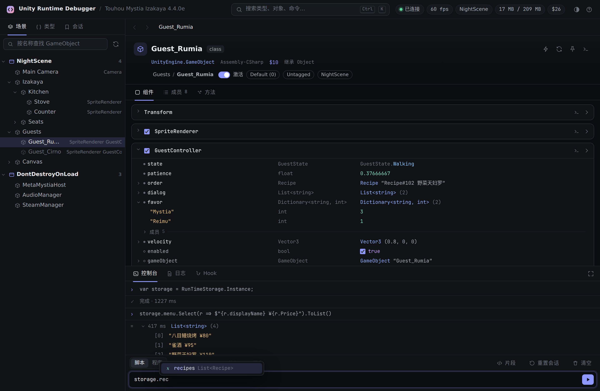

# Unity Runtime Debugger

Unity 运行时调试器：浏览场景与对象、读写成员、调用方法、执行 C#、Hook 方法。提供网页控制台、HTTP API 与命令行。



| 加载器 | 状态 |
| --- | --- |
| BepInEx 6 IL2CPP | 支持（Windows、Android） |
| BepInEx Mono | 计划中 |
| MelonLoader | 计划中 |

## 使用

将 `UnityRuntimeDebugger.dll` 放入 `BepInEx/plugins`，启动一次游戏后在 `BepInEx/config/UnityRuntimeDebugger.cfg` 中启用：

```ini
[Security]
Enabled = true
AcknowledgeRisk = true
```

启动日志会输出网页控制台地址。

- HTTP API：`GET /help`
- 命令行：`cli/urdbg.py`
- Android：`adb forward tcp:18765 tcp:18765`

## 构建

```sh
dotnet build src/BepInEx.Il2Cpp -c Release   # src/BepInEx.Il2Cpp/bin/Release/net6.0/UnityRuntimeDebugger.dll
dotnet test tests/Core.Tests
cd web && npx playwright test
```

`local.props` 中设置 `BepInExDir` 后，构建产物会复制到其 `plugins` 目录（见 `local.props.example`）。推送与 `Directory.Build.props` 中 `Version` 相同的 tag 即发布 Release。

## 致谢

[UnityExplorer](https://github.com/sinai-dev/UnityExplorer)、[BepInEx](https://github.com/BepInEx/BepInEx)

## 许可证

AGPL-3.0
